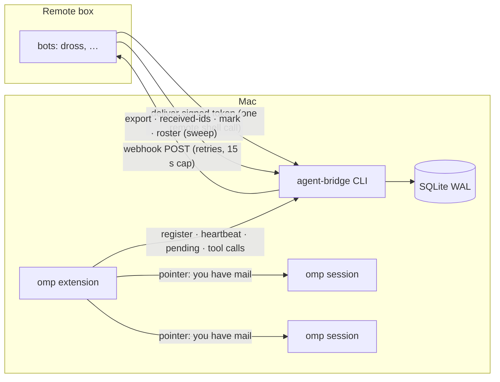

# agent-bridge

A signed, durable mailbox between omp (oh-my-pi) coding agents on a Mac and bots on a remote box that can only reach the Mac over HTTPS.

Every omp session registers itself, shows up in a live directory, and is woken inside omp when mail arrives, with no typing into terminals. Bots on the box send HMAC-signed tokens; the Mac imports them in one short command and wakes them back through a webhook.



## Why

Driving agents by typing into their tmux panes is fragile: a pane in copy mode swallows keys, a busy pane queues them, and nothing records whether a message was seen. This replaces that with a store that tracks each message through `queued → notified → read → acked`, delivery that is at least once, and a wake that goes through omp's own extension API.

## Trust model

- **The shared secret is the boundary.** Every message is HMAC-SHA256 signed over its canonical fields. Tokens from the box are verified on import; a forged or tampered token is rejected and logged. Nothing received is ever executed.
- **Box bots can't be impersonated on the Mac.** A box address is only accepted as a sender inside a verified token. The Mac CLI refuses to send as one.
- **Two tiers of authority.** A box bot's message is the owner's instruction. A message from another omp worker is a trusted coworker request: done by default, with a narrow set (sending as the owner, spending, deleting, credentials, anything touching other people) that waits for the owner. Each message's `bridge_read` header says which tier it is; the wording lives in the CLI and updates running sessions.
- **The roster comes from the box.** Which bots exist is set by a signed roster token. Bots it no longer lists are archived, not deleted. Replays of an older roster are ignored.

## Quickstart (Mac)

Requires Python 3.9+, omp, and tmux (optional).

```sh
git clone https://github.com/nategriffin26/agent-bridge && cd agent-bridge
mkdir -p ~/.agent-bridge && printf '{"side":"mac","owner":"Ada"}' > ~/.agent-bridge/config.json
# the same secret as the box, at least 32 characters
(umask 077; printf '%s' "$SHARED_SECRET" > ~/.agent-bridge/secret)
# optional: the webhook that wakes the box
(umask 077; printf 'AB_WEBHOOK_URL=%s\nAB_WEBHOOK_TOKEN=%s\n' "$URL" "$TOKEN" > ~/.agent-bridge/webhook.env)
./install.sh
```

`install.sh` links `~/bin/agent-bridge` to `src/agent_bridge.py` (moving any older copy aside), links the omp extension into `~/.omp/agent/extensions/`, and loads a launchd job that retries webhook sends every minute. `./install.sh rollback` undoes it. Nothing is deleted; replaced files are moved aside with a dated suffix.

New omp sessions now register and get `bridge_send`, `bridge_inbox`, `bridge_read`, `bridge_ack`, `bridge_reply`, `bridge_list_agents`, `bridge_whoami` and `bridge_status`.

```sh
agent-bridge agents            # who is live
agent-bridge status            # webhook queue, failures, unread
agent-bridge messages          # recent traffic and states
```

## Box side

The box keeps its own bridge copy (the v1 file under `tests/v1/` is wire-compatible) and reaches the Mac with one bounded shell command:

```sh
~/bin/agent-bridge deliver <token>              # import + wake, returns in well under 2 s; tokens on stdin also work
~/bin/agent-bridge export                       # outbound tokens the box has not confirmed
~/bin/agent-bridge received-ids                 # ids the Mac received, for the box to mark
~/bin/agent-bridge mark synced <id>...          # box confirms what it imported
~/bin/agent-bridge roster "$(python3 box/make-roster-token.py roster.json)"
```

`box/make-roster-token.py` signs `roster.json` (`[{"name": "dross", "label": "Dross"}, …]`) with the shared secret.

## Architecture

- **One file, stdlib only.** `src/agent_bridge.py` is the store, CLI, stdio MCP server, webhook pump and tmux fallback. One owner of all state.
- **Store.** SQLite in WAL mode at `~/.agent-bridge/v2/bridge.db`: `agents`, `agents_archive`, `messages`, `deliveries` (one row per message: state and timestamps), `events`, `meta`. Every statement retries a briefly locked store for up to 1.5 s, then exits 4; nothing hangs.
- **Identity.** `omp/<label>-<4 hex>`, where the label is `AB_SELF`, else the tmux session, else the folder, and the suffix comes from the omp session id, so `/reload` and `/resume` keep it. The tmux session name is an alias that resolves to the one live agent carrying it. Heartbeats every 30 s; `stale` after 120 s or a dead pid; `exited` on shutdown. The pump archives exited rows after an hour and stale rows after a day.
- **Wake.** The extension watches a per-agent notify file and asks the CLI for new mail. Idle sessions get a turn; busy ones get the pointer at the next step boundary. It never injects the message body.
- **Hot reload.** `extension/agent-bridge.ts` is a stable shim with fixed hooks and tools. It re-imports `extension/bridge-runtime.ts` whenever that file changes, so behavior updates reach running sessions within 3 s. The policy agents follow comes from `agent-bridge policy`; when its version changes, running sessions get the new text in context.
- **Mac → box.** Sends are stored first. A detached pump POSTs `{agent_bridge:1, id, from, to, token}` to the webhook with backoff (5 s to 10 min) and an absolute 15 s cap per attempt; launchd retries stranded rows every minute. If the webhook is down, the box sweep still pulls with `export`.
- **tmux, last resort.** For sessions without the extension, opt in with `touch ~/.agent-bridge/inject/<name>`: it leaves copy mode, targets the exact pane, types a one-line pointer, and every call is capped at 2 s.
- **Executor.** `executor-app/` exposes the MCP server through an [Executor](https://executor.sh) local gateway; callers pass `me`.

## Tests

```sh
python3 -m unittest discover -s tests     # about 20 s
python3 tests/e2e.py [--model M]          # a real omp worker in a throwaway tmux session
```

The unit tests run the real CLI against throwaway homes, with the v1 box code on the other side. They cover signing, dedupe, at-least-once redelivery, aliases, the roster, pruning, the webhook (down, slow, trickling), the tmux fallback with a fake tmux, and a locked store.

## License

MIT
