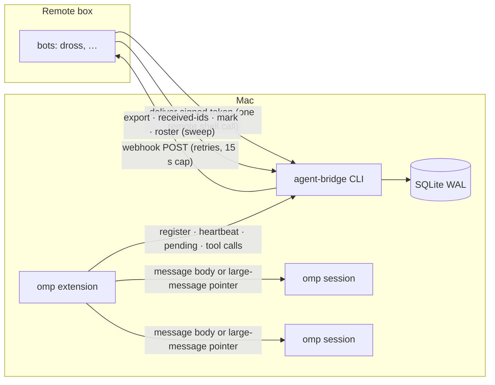

# agent-bridge

A signed, durable mailbox between omp (oh-my-pi) coding agents on a Mac and bots on a remote box that can only reach the Mac over HTTPS.

Every omp session registers itself, shows up in a live directory, and is woken inside omp when mail arrives, with no typing into terminals. Bots on the box send HMAC-signed tokens; the Mac imports them in one short command and wakes them back through a webhook.



## Why

The store tracks worker mail through `queued → notified → read`. The extension delivers bodies through omp's own API, without typing into terminals. Read means shown to the worker, not that the requested work is complete; unread messages remain eligible for the existing bounded retries.

## Trust model

- **The shared secret is the boundary.** Every message is HMAC-SHA256 signed over its canonical fields. Tokens from the box are verified on import; a forged or tampered token is rejected and logged. Nothing received is ever executed.
- **Box bots can't be impersonated on the Mac.** A box address is only accepted as a sender inside a verified token. The Mac CLI refuses to send as one.
- **Two tiers of authority.** A box bot's message is the owner's instruction. A message from another omp worker is a trusted coworker request: done by default, with a narrow set (sending as the owner, spending, deleting, credentials, anything touching other people) that waits for the owner. Each message's header says which tier it is, inline or through `bridge_read`. Reply only when the sender needs an answer or a result; never send thanks or acknowledgements. A requester may end a worker whose job is done; transcripts stay.
- **The roster comes from the box.** Which bots exist is set by a signed roster token. Bots it no longer lists are archived, not deleted. Replays of an older roster are ignored.

## Quickstart (Mac)

Requires Python 3.9+, omp, and tmux (optional).

```sh
git clone https://github.com/nategriffin26/agent-bridge && cd agent-bridge
mkdir -p ~/.agent-bridge && printf '{"side":"mac","owner":"Ada"}' > ~/.agent-bridge/config.json
# the same secret as the box, at least 32 characters
(umask 077; printf '%s' "$SHARED_SECRET" > ~/.agent-bridge/secret)
# optional: the webhook that wakes the box
(umask 077; printf 'AB_WEBHOOK_URL=%s\nAB_WEBHOOK_TOKEN=%s\n' "$URL" "$TOKEN" > ~/.agent-bridge/webhook.env)
./install.sh
```

`install.sh` links `~/bin/agent-bridge` to `src/agent_bridge.py` (moving any older copy aside), links the omp extension into `~/.omp/agent/extensions/`, and loads a launchd job that retries webhook sends every minute. `./install.sh rollback` undoes it. Nothing is deleted; replaced files are moved aside with a dated suffix.

New omp sessions register and get `bridge_send`, `bridge_inbox`, `bridge_read`, `bridge_reply`, `bridge_list_agents`, `bridge_whoami` and `bridge_status`. Existing sessions need `/reload` to remove the old `bridge_ack` tool and refresh tool descriptions. Inline delivery and policy updates need no reload.

```sh
agent-bridge agents            # who is live
agent-bridge status            # webhook queue, failures, unread
agent-bridge messages          # recent traffic and states
```

Give a job a named thread with `agent-bridge send omp/requester omp/worker --thread job-slug "question"` or `bridge_send({to, message, thread: "job-slug"})`. Replies inherit the thread. Without a thread, a root message uses its own id, as before.

## Box side

The box keeps its own bridge copy (the v1 file under `tests/v1/` is wire-compatible) and reaches the Mac with one bounded shell command:

```sh
~/bin/agent-bridge deliver <token>              # import + wake, returns in well under 2 s; tokens on stdin also work
~/bin/agent-bridge export                       # outbound tokens the box has not confirmed
~/bin/agent-bridge received-ids                 # ids the Mac received, for the box to mark
~/bin/agent-bridge mark synced <id>...          # box confirms what it imported
~/bin/agent-bridge roster "$(python3 box/make-roster-token.py roster.json)"
```

`box/make-roster-token.py` signs `roster.json` (`[{"name": "dross", "label": "Dross"}, …]`) with the shared secret.

## Local bots

A bot that runs on the Mac behind its own HTTP endpoint gets a bridge address too:

```sh
agent-bridge local add ops --label Ops --webhook http://127.0.0.1:3100/api/v1/bots/ops/webhook --token-file ~/.ops-token
agent-bridge send --as ops --token-file ~/.ops-token [--reply-to ID] [--thread JOB] omp/worker "done"
agent-bridge local rm ops
```

- Mail to it is POSTed to its webhook with its bearer token: the box payload plus plain `body`, `reply_to` and `thread`. A 2xx counts as delivered; failures retry with the same backoff.
- `send --as` proves the sender by its token file, so its messages carry the owner's authority like a box bot's.
- The database stores the token file's path, never the token. Adding a local bot archives a box bot of the same name, and later box rosters can't bring it back while the local one exists.

## Architecture

- **One file, stdlib only.** `src/agent_bridge.py` owns the store, CLI, stdio MCP server and webhook pump.
- **Store.** SQLite in WAL mode at `~/.agent-bridge/v2/bridge.db`: `agents`, `agents_archive`, `messages`, `deliveries` (message state and aggregate timestamps/counters), `notifications` (retry count and timestamp per message/session), `events`, `meta`. `AB_HOME` overrides `~/.agent-bridge` for both CLI and extension. `agent-bridge migrate` applies schema upgrades, also applied on connection. Schema 4 maps inbound `acked` to `read`, preserving `read_at` or using the former `acked_at`; outbound box confirmations retain `acked`. Message contents, threads and notification history stay unchanged. Back up an existing store before upgrading. Every statement retries a briefly locked store for up to 1.5 s, then exits 4.
- **Identity.** `omp/<label>-<4 hex>`, where the label is `AB_SELF`, else the tmux session, else the folder, and the suffix comes from the omp session id, so `/reload` and `/resume` keep it. The tmux session name is an alias that resolves to the one live agent carrying it. Heartbeats every 30 s; `stale` after 120 s or a dead pid; `exited` on shutdown. The pump archives exited rows after an hour and stale rows after a day.
- **Alias handoff.** Unread alias mail bound to a dead or stale session is released when another carrier checks its inbox, polls pending mail, or heartbeats; registration, exit and pruning also release it. Existing live carriers need not register again. Exact-ID mail and already-read mail stay with their recipient. Unresolved alias mail is visible to every carrier until one reads it; pending notifications are not exclusive claims, so concurrent carriers can see the same message.
- **Wake.** The extension watches a per-agent notify file and asks the CLI for new mail. Bodies up to 16 KiB (UTF-8) arrive inline with id, sender, reply/thread and trust header; larger bodies carry the same header and an id for `bridge_read`. Idle sessions get a turn; busy ones receive mail at the next step boundary. After handing inline bodies to omp, the extension marks them read. A crash before that write leaves them eligible for re-pointing; a crash after it does not retry the work. The per-session three-pointer budget and 15-minute retry interval are unchanged.
- **Hot reload.** `extension/agent-bridge.ts` fixes hooks and tools at load; changes there require `/reload`. It re-imports `extension/bridge-runtime.ts` on changes, so runtime updates reach running sessions within 3 s. Policy changes arrive in context through `agent-bridge policy` without restarting.
- **Mac → box.** Sends are stored first. A detached pump POSTs `{agent_bridge:1, id, from, to, token}` to the webhook with backoff (5 s to 10 min) and an absolute 15 s cap per attempt; launchd retries stranded rows every minute. If the webhook is down, the box sweep still pulls with `export`.
- **Executor.** `executor-app/` exposes the MCP server through an [Executor](https://executor.sh) local gateway; callers pass `me`.

## Tests

```sh
python3 -m unittest discover -s tests
bun test tests/runtime.test.ts          # injection precedes the read write, idle and busy
python3 tests/e2e.py [--model M]          # a real omp worker in a throwaway tmux session
formal/check.sh                         # inbound wake and shared-alias routing models
```

The unit tests run the real CLI against throwaway homes, with the v1 box code on the other side. They cover signing, dedupe, unread retries, inline/pointer boundaries, read-at-injection, named threads, migration, aliases, the roster, pruning, webhook failures, bounded tmux registration and a locked store. The box sweep still uses `received-ids` and `mark delivered|synced`; `export-acks` reports worker mail as read and preserves its JSON fields.

## License

MIT
